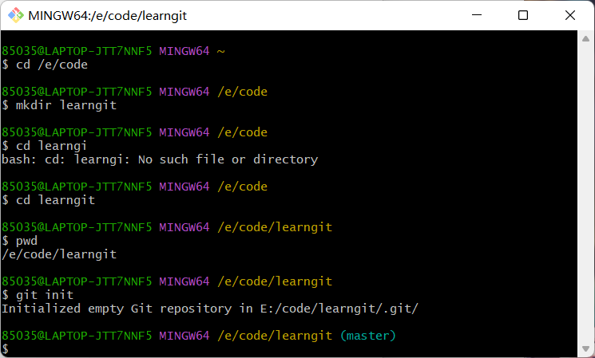
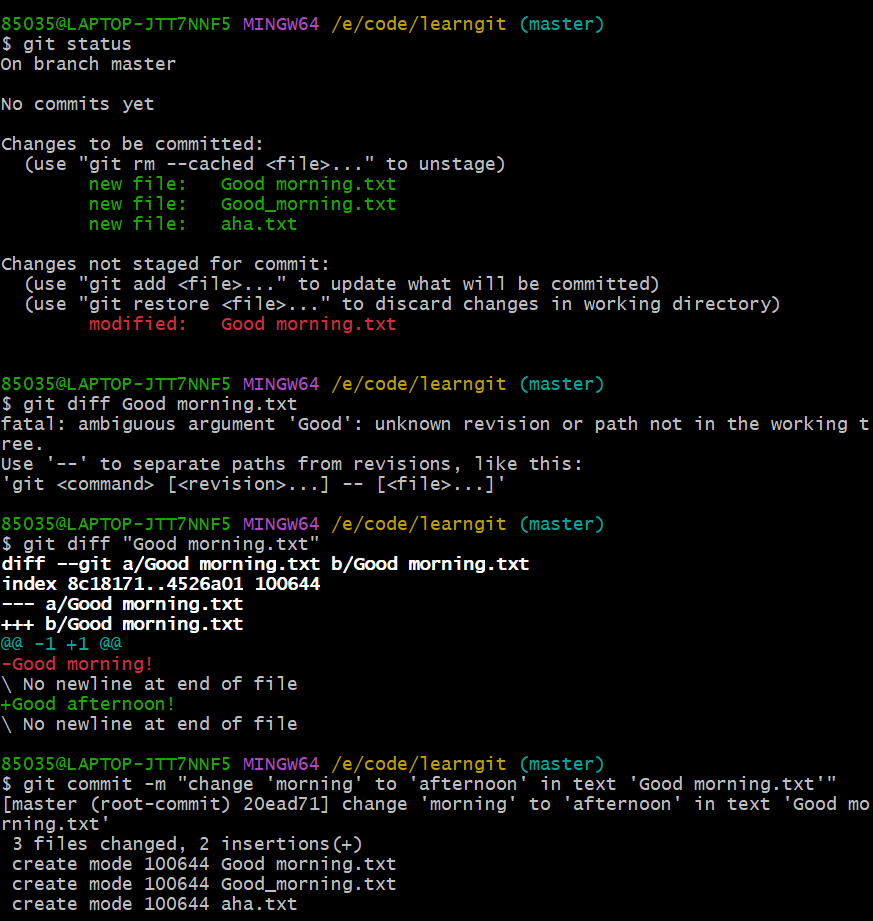

# Git 学习笔记

参考资料：
[1] [GitHub 官方文档](https://docs.github.com/zh)
[2] [Git 教程|菜鸟教程](https://www.runoob.com/git/git-tutorial.html)
[3] [Git 教程 by 廖雪峰](https://liaoxuefeng.com/books/git/introduction/index.html)
[4] [CSDN：Git 安装教程（超详细）](https://blog.csdn.net/qq_45281589/article/details/134650456)
[5] [【官方教程】起步-初次运行-Git-前的配置](https://git-scm.com/book/zh/v2/起步-初次运行-Git-前的配置)

扩展知识：
[震惊！竟然有人在 GitHub 上冒充我的身份！](https://spencerwoo.com/blog/wait-this-is-not-my-commit)

如果需要学习 GitHub 相关拓展知识，请移步以下链接：
[1] [GitHub 汉化教程](https://blog.csdn.net/chu1025631/article/details/138764774)
[2] [GitHub 学习笔记](.\GitHub学习笔记.md)

写在前面：
当前是学习笔记的初稿，大部分参照廖雪峰的 Git 教程完成的记录。其课程特点是案例式教学，但我在记录笔记时，并没有完整记录他的场景描述，而是侧重于记录教程中的指令以及我在学习、实操过程中自己的一些看法，如果你对我记录的信息有疑问，可以给我提一些建议，也可以通过前面的链接直接通过廖雪峰的教程。

初稿为您的学习之路带来的不便还请谅解！

若您想快速完成 Git 的配置投入使用，请[点击这里](./Git学习笔记.md#git-快速配置指南)查看快速配置指南。

## Git 简介

git 的特点：
版本控制系统

## 安装 Git

参考资料：[廖雪峰：安装 Git](https://liaoxuefeng.com/books/git/install-git/index.html)

安装程序参照参考资料[4]，下面讲一下安装后必要的设置。

### 指定用户名和邮箱地址

用户名和邮箱地址是 Git 记录提交信息的关键凭据，在 Windows 环境（命令行）下可以用以下命令设定：

```sh
git config --global user.name "Your Name"
git config --global user.email "youremail@example.com"
```

`global`表示命令对这台电脑上的所有用户生效。若使用的命令行工具是`Git Bash`，则每条指令前会有`$`，一般会自动加上。

在引号中填写你的昵称和邮箱即可。

然后你可以通过以下命令查看你刚设定的信息：

```sh
git config --global user.name
git config --global user.email
```

也可以输入以下命令查看所有配置信息：

```sh
git config --list
```

## Git 基本操作

### 创建 Git 版本库（仓库）

由于每个人的习惯不同，或许你现在正在使用的是`Shell`或者其他的一些工具，但本教程将使用刚才安装上的`Git Bash`进行讲解。

你如果是一个图方便的初学者，你可以依次在`bash`中输入以下命令，这样做你就建好了第一个 git 仓库。

```bash
$ mkdir learngit
$ cd learngit
$ pwd
$ git init
```

下面我们来解释下它们的含义：

1. `mkdir learngit`：在当前目录下创建一个名为`learngit`的文件夹。
2. `cd learngit`：切换到`learngit`文件夹。
3. `pwd`：查看当前所在目录。
4. `git init`：在当前目录下创建一个 git 仓库。

具体的效果如下图所示：


从上图中可以发现，git 给了你如下提示：

```sh
Initialized empty Git repository in ???
```

这条提示表示，git 已经成功创建了一个空的 git 仓库。
这样创建的仓库会被创建在默认的 c 盘当中，所以下面我们来介绍一种可以将仓库创建在任意目录下的方法。

```bash
$ cd /e/code
$ mkdir learngit
$ cd learngit
$ pwd
$ git init
```

如下图所示：


`cd /e/code`：切换到`/e/code`目录。注意，第一个斜线必须加，表示这个路径是**绝对路径**，不然`Git Bash`找不到路径。

好吧，或许你非常的轴，还在用 Shell，然后发现`$ pwd`和`$ cd /e/`用不了，偷偷告诉你，你只需要输入`cd`就可以查看当前路径（但前面有显示的啊），输入`e:`然后回车，就可以跳转到别的盘了。

无论如何，你现在已经成功创建了一个 git 仓库了，在你创建的仓库中，你会发现一个名为`.git`的文件夹，众所周知，前面带个点八成是个配置文件，这个文件中存了所有的提交记录，不要动它就对了。

### 一些常用指令

创建一个文件是十分简单的事情，直接右键就可以了。这么简单的当然不是我们要讲的，我们要讲的是如何让 git 追踪到这些文件。
下面我将用一个例子来讲明`Git Bash`常用命令：

首先，我们在之前建立的仓库`learngit`中创建一个名为`Good morning.txt`和一个名为`Good_morning.txt`的文本文件，并输入以下内容：

```txt
Good morning!
```

1. `git add`
   好了，现在我们需要让 git 和我们刚创建的这个文件认识一下了。
   使用如下命令将文件添加进 git 仓库：

```bash
$ git add Good_morning.txt text.txt     #可以用这个方法添加多个文件
$ git add "Good morning.txt"            #当添加的文件名中有空格时，需要用双引号括起来
$ git add .                             #添加所有文件进入仓库
$ git add *                             #功能同上一条
```

2. `git status`
   命令用于查看当前仓库的状态。
   可以通过输入这条命令，查看当前仓库中哪些文件被修改了，哪些文件被删除了，哪些文件被添加了。

3. `git commit`
   用于提交更改，具体命令如下所示：

   ```bash
   $ git commit -m "commit message"         #这是一个普通的提交信息
   $ git commit --allow-empty-message -m "" #这是一个允许提交空信息的方法，但不推荐使用。

   $ git commit amend -m "commit message"   # amend表示修改上一次的提交信息
   ```

   一般来说，一条提交信息应该在其后面写明当前提交的信息做了什么修改，以便多人协作时，能快速了解修改情况。当然，也可以不写，方法已经给出，但是不推荐。

4. `git diff`
   用于查看文件的具体修改情况。
   比如我现在将`Good_morning.txt`中的`morning`改为`afternoon`，然后输入`git diff`，就会看到如下结果：
   

5. `git log`
   用于查看当前仓库的历史日志。
   可以用下列命令精准查看日志：

   ```bash
   $ git log --pretty=oneline #只显示一条日志

   #
   $ git log --graph --pretty=oneline --abbrev-commit
   ```

6. `git reset`
   用于版本回退，具体用法如下

   ```bash
   $ git reset --hard HEAD^
   $ git reset --hard HEAD~1        # 回退到上一版本已提交时的状态
   $ git reset --soft HEAD~1        # 回退到上一版本未提交时的状态
   $ git reset --mixed HEAD~1       # 回退到上一个版本已添加但未提交的状态
   $ git reset --hard < commit id > # 回退到指定版本

   $ git reset HEAD < filename >    # 将指定文件状态恢复到最后一次提交后的状态。
   ```

   前两条指令效果一样，`HEAD`后面`^`的个数代表回退的版本数，当回退版本过多时，也可以选择使用`~`，例如`HEAD~10`。
   也可以用`commit id`（就是`git log`中每条提交记录后面那一长串哈希值，可以通过指令`git reflog`找到）回退到指定版本。
   **注意**：也可以直接使用`HEAD`在不改变版本的情况下，只针对最后一次提交后的操作进行修改。

   详细点讲：

   1. `--hard`会清除暂存区和工作区的全部修改，然后回到指定版本提交完的时点。
   2. `--soft`不清除、修改任何区域的数据，仅回退到指定版本提交后的时间点，此时，`git status`会将暂存区和工作区修改与上一个版本提交时的状态进行比较，并显示出修改情况。
   3. `--mixed`仅会清除暂存区记录，并回到指定版本提交后的时间点。

   换个方式理解：`hard`硬回退，抹除所有未提交数据；`soft`软回退，只改变版本，不影响数据；`mixed`混合回退,只清除暂存区。

7. `cat <filename>`
   用于查看某一文件的具体内容，如：

   ```bash
   cat Good_morning.txt
   ```

8. `git checkout --  <filename>`
   这条指令将放弃目标文件未添加进暂存区的所有修改。也可以理解为，将当前文件还原到最后一次向暂存区提交时的状态。
   这里的`--`表示后面不是一条指令，而是一个文件路径，`--`须加一个空格，不然会被识别成命令。

9. `git rm <filename>`
   用于将指定文件移出 git 仓库。

10. `git rebase`
    用于整理提交历史（？？？）

## 使用 GitHub 远程仓库

### 基本设置

以 Windows 为例，查看当前用户主目录下，有无`.ssh`文件夹，其中有没有`id_rsa`和`id_rsa.pub`文件，如果没有，则需要生成密钥对，打开`Git Bash`并输入以下命令：

```bash
$ ssh-keygen -t rsa -C "your_email@example.com"
```

其中：
`ssh-keygen`是生成密钥对的命令；
`-t rsa`表示生成 rsa 类型的密钥对；
`-C "your_email@example.com"`表示生成密钥对的备注信息，这里可以写上自己的邮箱，易于识别设备。

然后你可以注册一个 GitHub 账号，通过`'Account Settings'->'SSH and GPG keys'`将文件`id_rsa.pub`中的内容粘贴到`SSH Keys`中。

**在最新的 GitHub 中，需要选择使用认证密钥（Authorized keys）还是签名密钥（signed keys），这里我选择的签名密钥，至于为什么，我是问的通义千问，等我搞明白了再回来改**
通义千问都是骗人的！我用的认证密钥，然后过了。

### 将本地仓库与远程仓库关联(本节仍可完善)

配置好密钥后，就可以向 GitHub 推送仓库了。

现在，先在你的 GitHub 上创建一个名为`learngit`的仓库，然后你可以通过下述命令将本地仓库与远程仓库关联：

```bash
# 将远程仓库添加进本地仓库，并命名为origin
$ git remote add origin git@github.com:your_username/your_repo_name.git

# 将本地仓库的master分支推送到远程仓库origin，并与仓库建立关联
$ git push -u origin master
$ git push --set-upstream origin master
```

1. `origin`是自定义的远程仓库名称，叫做`origin`是一种惯例。
2. `-u` 或 `--set-upstream` 选项用于设置本地分支与远程分支之间的跟踪关系。这通常在**第一次推送**时使用，以便以后可以方便地推送或拉取。
   这里是将`master`分支推送到了远程仓库`origin`中，并建立联系。
   然后你就可以在对应的仓库中看到刚刚创建的`master`分支了。
3. 关联好远程仓库后，就可以通过`git push origin master`将本地仓库中的修改直接推送到远程仓库了。

其他关于远程仓库的一些指令：

1. `git remote -v`：查看所有远程仓库的信息，包括名称、地址等。
2. `git remote rm origin`：删除远程仓库`origin`。

### 从远程库克隆

用如下命令可以克隆远程仓库（即将目标位置的代码下载到本地当前位置）：

```bash
$ git clone https://github.com/your_username/your_repo_name.git <dirname>             # 使用https协议克隆项目
$ git clone git@github.com:your_username/your_repo_name.git <dirname>                 # 使用ssh协议克隆项目
$ git clone https://github.com/your_username/your_repo_name.git
$ git clone git@github.com:your_username/your_repo_name.git
```

可以使用 ssh 或 https 协议克隆项目，若在网址后加上名称`<dirname>`，则项目会被下载到名为`<dirname>`的文件夹中，否则，将下载到与仓库同名的`your_repo_name`文件夹中。

**据廖雪峰说，http 速度慢且每次需要输入口令，所以建议使用 ssh，但我没搞明白为什么，搞明白了我回来补**

## Git 分支

Git 分支的本质，就是控制指针的位置。从之前的内容可知，Git 中有一个指针`HEAD`会指向一个版本，你之后做的一切更改都是在这个版本基础上。但实际上，这个指针并不是直接指向版本，而是指向一个分支（如`master`），而分支同样是一个指针，它才是真正指向了一个版本。所以，Git 分支的控制，实际上就是一个创建、删除、移动指针的过程。

### 创建与合并分支

可以使用如下指令创建、切换分支：

```bash
$ git branch <branch_name>          # 创建分支
$ git checkout <branch_name>        # 切换分支

$ git checkout -b <branch_name>     # 创建并切换分支
$ git checkout -b <branch_name> <branch_name_exist>     # 创建并切换分支，分支指向已存在的分支


# 在较新的Git版本中，还可以使用以下命令
$ git switch <branch_name>          # 切换分支
$ git switch -c <branch_name>       # 创建并切换分支
```

切换分支时，你在该分支上提交的所有修改都不会被保留，但工作区和暂存区的更改会被保留。

可以使用如下命令合并分支：

```bash
$ git merge <branch_name>        # 合并其他分支到当前分支
$ git merge                      # （具体功能不明）

# 合并结束后，可以用此命令删除多余的分支
$ git branch -d <branch_name>    # 删除分支

$ git merge --abort              # 放弃合并（当发生合并冲突时使用此命令退出merging状态）
```

**注意**：合并其他分支的`git merge <branch_name>`命令，会将当前分支的指针挪到`<branch_name>`分支的版本。但前提是`<branch_name>`相较于当前分支有更改，否则，不会产生任何影响。换句话说，指针在当前情况下只会前进。

一些反馈信息：

```bash
# 由于指令不完全，给出报错：未关联远程分支。merge一般情况下要跟一个分支名。
85035@LAPTOP-JTT7NNF5 MINGW64 /e/code/learngit (new_branch)
$ git merge
fatal: No remote for the current branch.

# 此时new_branch分支在master分支之前，无法merge。
85035@LAPTOP-JTT7NNF5 MINGW64 /e/code/learngit (new_branch)
$ git merge master
Already up to date.

# 这里表示merge成功，返回信息显示使用Fast-forward模式将指针前移。
85035@LAPTOP-JTT7NNF5 MINGW64 /e/code/learngit (master)
$ git merge new_branch
Updating becd9a0..53ebf79
Fast-forward
 aha.txt | 4 +++-
 1 file changed, 3 insertions(+), 1 deletion(-)


```

### 解决冲突

当你创建一个新分支，然后基于两个不同的分支作了不同的修改时，Git 就会提示你分支发生了冲突。
这时就需要对产生冲突的文件进行手动修改，然后提交。
在一个文件发生冲突的位置，通常会呈现如下形式：

```text
<<<<<<< HEAD
this is line 1
===========
this is line 2
>>>>>>>> new_branch
```

将这一部分修改后提交，即可合并分支。

当然，还有别的方法。

```bash
# 在不触发Fast-forward的情况下，提交一个新版本并完成合并。
$ git merge --no-ff -m "merge message" <branch_name>
```

这条指令的好处是可以保留分支历史（别问我，我不懂，自己理解一下）
据我实测，两种方式都可以保留分支信息，可能是版本更新了的缘故。

可以采用以下命令查看分支发生的事：

```bash
$ git log --graph --pretty=oneline --abbrev-commit
```

## 分支策略

所谓分支策略，就是尽量不动主分支（`master`或`main`），创建多条分支用于多人协作提交代码，最后将所有人的工作成果汇总到一起。

## Bug 分支

假设现在主分支`master`上出现了一个 bug，但切到 master 分支不可避免的会丢掉你当前所在的分支`my_branch`的工作进度，可是工作没有做完让你无法提交更改，那么我们可以：

```bash
$ git stash
```

这样可以将当前工作现场暂存起来，等 bug 解决后再恢复回来：

```bash

$ git stash pop         # 弹出当前最新的更改，同时将此项更改从暂存区移除

$ git stash list        # 查看暂存区中的更改

# 本方法
$ git stash apply        # 恢复暂存区中的更改
$ git stash drop        # 删除暂存区中最新的更改
$ git stash clear       # 清空暂存区

```

当然，在`master`上存在的 bug 自然也存在于`my_branch`上，所以：

```bash
$ git cherry-pick <commit_id>
```

以此法复制更改。

## feature 分支（删除分支）

当开发一个新功能时，建议在新建的一个 feature 分支上进行，当功能完成后，再合并到`master`分支。

```bash
$ git branch -d <branch_name> # 删除分支
$ git branch -D <branch_name> # 强制删除分支
```

两者的区别在于，如果分支有未提交的更改，`-d`命令会提示你，但`-D`命令会强制删除。

## 多人协作基础

### 远程仓库相关指令

```bash
#查看远程仓库信息
$ git remote # 查看远程仓库
$ git remote -v  # 查看远程仓库的详细信息fetch与push，有push证明对该仓库有提交权限。

# 向远程仓库推送
$ git push origin <branch_name> # 将本地分支推送到远程仓库origin的同名分支

# 从远程仓库拉取
$ git clone <remote_repo_url> <local_repo_name> # 从远程仓库克隆到本地
$ git checkout -b <branch_name> <remote_repo_url>/<branch_name> # 创建一个跟随远程分支的分支

```

### 意外事件

1. push 时与远程仓库发生冲突

   这时就需要用`pull`将远程仓库的提交抓取到本地，然后进行分支合并。

   ```bash
   $ git pull # 将远程仓库的提交抓取到本地

   # 如果抓取失败，输入下方命令
   $ git branch --set-upstream-to=origin/<branch_name> <branch_name> # 将本地分支与远程分支关联


   ```

## 标签管理

```bash
$ git tag <tag_name> <commit_id> # 创建一个标签
$ git tag <tag_name>             # 为当前分支的最新提交（HEAD）创建一个标签
$ git tag -a <tag_name> -m "tag message" <commit_id> # 为指定提交创建一个标签，并附简单描述。

$ git tag                        # 查看所有标签
$ git show <tag_name>            # 查看标签信息（名称、创建时间、创建者、描述等）

```

对标签的一些操作

```bash
$ git tag -d <tag_name>          # 删除标签
$ git push origin <tag_name>     # 推送标签至远程仓库
$ git push origin --tags         # 推送所有标签至远程仓库

# 删除远程仓库的标签
$ git tag -d <tag_name>                   # 先在本地删除
$ git push origin :refs/tags/<tag_name>   # 再推送
```

## 关于 GitHub

你的 GitHub 仓库中一般有这两类代码：自己的和别人的。自己的代码通过自己 push 得到，而别人的代码通常通过 Fork 得到。（Fork 是 GitHub 的功能，一般在项目页的右上方。

当你 Fork 了别人的代码，发现了一些问题，想告诉原作者时，你可以通过 GitHub 中`Pull Request`功能向原作者提交你的修改。具体流程为：

```bash
Fork别人的代码到自己的仓库->克隆自己仓库的代码到本地->修改代码后提交->在GitHub中提交Pull Request->原作者审核
```

这样你就可以在使用其他作者的作品同时，为其提一些宝贵的建议了。

## 关于 Gitee （码云）

与 GitHub 类似，在 Gitee 上存储代码，也需要 SSH 密钥、创建项目、关联远程库等操作。**但请注意**，之前讲过，我们将远程仓库 GitHub 命名为`origin`，那么 Gitee 就不能使用这个名字了，你需要给这个远程库起一个新名字比如`gitee`。

```bash
$ git remote add gitee <gitee_repo_url> # 创建一个新的远程仓库，位于Gitee，名为'gitee'


# 也可以先将GitHub的关联信息删除，再关联Gitee
$ git remote rm origin
$ git remote add origin <gitee_repo_url>
```

如果你同时关联了多个远程仓库，那么`git remote -v`的信息也会增多。

## 玩转 Git

1. `.gitignore`
   总会有一些文件，你需要将其放在 Git 的工作目录中，但又不能随项目上传（比如数据库密码配置文件等）。这时，你可以创建一个名为`.gitignore`的文件，将这些文件名填入其中。GitHub 有一些 `.gitignore` 模板，可以参考：
   https://github.com/github/gitignore
   [廖雪峰：忽略特殊文件](https://liaoxuefeng.com/books/git/customize/ignore/index.html)

   - 当你成功忽略掉部分文件后，当你再尝试将这些文件`add`到 Git 中时就会报错，这时也是有办法的，通过`git add -f <file_name>`就可以强制添加了。
   - 还可以用`git check-ignore -v <file_name>`来查看为什么`<file_name>`不能添加。
   - 还可以在`.gitignore`文件中的规则以`!`开头来表示例外，比如`!.gitignore`，即为不忽略`.gitignore`文件（类似于白名单）。
   - `.gitignore`还可以放在某个子文件夹下，表示忽略只针对该子目录。

2. 配置别名
   那么多指令，不仅不好记，还容易输错！
   下面的这个方法可以将 Git 的常用指令配置为别名，这样你就可以输入`git st`来代替`git status`。其他命令同理

   ```bash
   $ git config --global alias.st status # 将git status命令配置为st

   ```

   或许你在想，正经命令还没记全，这些骚操作还是算了吧。别急，还记得前面输的哪条指令不变，还又臭又长吗？

   ```bash
   $ git config --global alias.lg "log --color --graph --pretty=format:'%Cred%h%Creset -%C(yellow)%d%Creset %s %Cgreen(%cr) %C(bold blue)<%an>%Creset' --abbrev-commit"
   ```

   下回我就可以用`git lg`来代替`git log --color --graph --pretty=format:'%Cred%h%Creset -%C(yellow)%d%Creset %s %Cgreen(%cr) %C(bold blue)<%an>%Creset' --abbrev-com`了，输出的历史记录简洁又美观。

3. 配置服务器
   开始偷懒，先不写了。
   [廖雪峰：配置 Git 服务器](https://liaoxuefeng.com/books/git/customize/server/index.html)

## GUI 工具 SourceTree

可以通过[SourceTree 官网](https://www.sourcetreeapp.com/)下载这个工具。

# Git 快速配置指南

若您使用的是 Windows 操作系统，请准备好 Git Bash 软件，Linux/Mac 直接使用命令行工具。

#### 配置密钥

1. 生成 rsa 密钥对。
   ```sh
   ssh-keygen -t rsa -C "<your_email>"
   ```
2. 在 GitHub 添加公钥。
   在`设置-SSH与GPG公钥-新建SSH密钥-添加认证密钥`中粘贴生成的`~/.ssh/id_rsa.pub`文件中的内容。

#### 指定用户名和邮箱地址

```sh
git config --global user.name "Your Name"
git config --global user.email "youremail@example.com"
```

项目中没有找到这三个现成标题，因此我没有擅自修改某份文档。下面内容可以直接接在已有基础知识后面。

# Git 行为规范

## 基本内容

项目采用简化的 GitHub Flow：

```text
main
 ├─ feat/功能名称
 ├─ fix/问题名称
 ├─ refactor/重构名称
 ├─ docs/文档名称
 └─ hotfix/紧急修复名称
```

| 类型 | 使用场景 |
|---|---|
| `feat` | 增加新功能 |
| `fix` | 修复错误 |
| `test` | 增加或调整测试 |
| `refactor` | 重构代码，但不改变外部行为 |
| `docs` | 修改文档 |
| `chore` | 项目维护、初始化、清理 |
| `build` | 构建工具和依赖调整 |
| `ci` | 自动化流水线调整 |
| `perf` | 性能优化 |
| `revert` | 撤销已有提交 |

| 分支 | 用途 | 是否长期存在 |
| --- | --- | --- |
| `main` | 稳定、可部署代码 | 是 |
| `feat/*` | 新功能 | 否 |
| `fix/*` | 普通缺陷修复 | 否 |
| `hotfix/*` | 线上紧急修复 | 否 |
| `refactor/*` | 不改变行为的重构 | 否 |
| `test/*` | 测试建设 | 否 |
| `docs/*` | 文档修改 | 否 |
| `chore/*` | 构建、工具和仓库维护 | 否 |
| `ci/*` | 持续集成配置 | 否 |

### 1. 主分支规则

`main` 代表随时可以测试、打包或发布的代码。

团队统一遵守：

- 不直接在 `main` 上开发。
- 不直接向 `main` 强制推送。
- 一个分支只解决一个问题。
- 功能通过测试和审查后才能合并。
- 已经推送的公共提交不随意改写历史。
- 生产版本必须从 `main` 创建标签。

### 2. 分支命名

分支名称全部使用小写英文，单词用短横线连接：

```text
feat/user-register
feat/user-login
fix/duplicate-username
fix/login-session
refactor/password-service
test/user-register
docs/git-guide
hotfix/security-validation
release/v0.1.0
```

不要使用：

```text
test
new
dev1
我的分支
修改一下
feature123
```

### 3. 开发一个功能的标准流程

首先更新主分支：

```powershell
# 切换到 main 主分支
git switch main

# --ff-only：只允许快进更新，禁止自动产生额外的合并提交
git pull --ff-only
```

创建功能分支：

```powershell
# -c：创建新分支并立即切换过去
git switch -c feat/user-register
```

开发过程中随时检查：

```powershell
git status
git diff
```

完成一个独立、可验证的改动后提交：

```powershell
git add src/main/java/具体文件
git add src/test/java/具体文件

git diff --cached --stat
git diff --cached
git commit -m "feat(user): 增加用户注册接口"
```

第一次推送分支：

```powershell
# -u：建立本地分支与远程分支的跟踪关系
# origin：远程仓库的默认别名
git push -u origin feat/user-register
```

然后在 GitHub 创建 Pull Request，完成：

1. 自动测试。
2. 人工代码审查。
3. 配置和敏感信息检查。
4. 功能验收。
5. 合并到 `main`。

合并后更新本地并删除旧分支：

```powershell
git switch main
git pull --ff-only
# -d：安全删除已经合并的本地分支
# 如果分支尚未合并，Git会拒绝删除
git branch -d feat/user-register
```

确定远程分支不再需要后：

```powershell
# --delete：删除远程仓库中的指定分支
git push origin --delete feat/user-register
```

### 4. 多久提交一次

不按照“写了多少行”或“AI回答了几次”决定提交，而是按照逻辑目标决定。

适合提交的时机：

- 一个接口可以独立运行。
- 一个问题已经完整修复。
- 一次重构完成且行为没有变化。
- 一组测试已经补齐并通过。
- 一份文档已经形成完整主题。
- 当前状态可以被安全回退。

不适合提交的状态：

- 代码无法编译。
- 功能只完成一半。
- 测试仍然失败。
- 调试代码尚未删除。
- 同时混入多个无关功能。
- 尚未检查 AI 生成的代码。

一般情况下，一个小功能可以有多个提交，但一次提交只表达一个目的。

### 5. AI 编程时的提交点

不要让 AI 每修改一次就提交，也不要等多个功能全部完成后只提交一次。

推荐流程：

```text
明确一个小目标
→ AI实现
→ 人工检查差异
→ 编译和测试
→ 修正问题
→ 再次检查
→ 形成一个有意义的提交
```

AI生成代码后至少检查：

```powershell
git diff
mvn test
git status
```

重点确认：

- 是否修改了任务范围之外的文件。
- 是否覆盖了配置和密码。
- 是否增加了无用依赖。
- 是否留下临时类、日志和测试数据。
- 是否真的满足业务要求。
- 是否存在表面通过但逻辑错误的实现。

AI中间尝试产生的 `WIP` 提交不要直接合并到主分支。合并前应整理、合并或删除无意义提交。

### 6. 同步主分支

其他成员合并代码后，开始新任务前执行：

```powershell
git switch main
git pull --ff-only
git switch -c feat/新功能
```

如果自己的功能分支开发期间 `main` 已更新：

```powershell
# origin：从名为 origin 的远程仓库获取最新记录
# fetch 只下载记录，不直接修改当前工作区
git fetch origin

git switch feat/当前功能

# origin/main：本地保存的远程 main 分支状态
# 将远程 main 的更新合并到当前功能分支
git merge origin/main
```

发生冲突时：

1. 阅读双方代码。
2. 确认应该保留的业务行为。
3. 修改冲突文件。
4. 重新测试。
5. 提交冲突处理结果。

不要在不了解代码的情况下直接选择“全部保留当前”或“全部接受对方”。

### 7. 回退已经合并的功能

团队主分支已经包含后续提交时，使用 `git revert`，不要使用 `reset --hard`。

例如：

```text
A：用户注册
B：用户登录
```

现在只撤销注册，不撤销登录：

```powershell
git log --oneline
git revert A的提交编号
git push
```

`git revert` 会创建一个新的反向提交，因此不会删除后面的登录历史。

`git reset` 主要用于尚未共享的本地提交，不用于随意回退团队主分支。

### 8. 忽略文件管理

`.gitignore` 应在第一次 `git add` 之前准备好。

提交前检查是否有被忽略的文件误入暂存区：

```powershell
git ls-files --cached --ignored --exclude-standard
```

正常情况应当没有输出。

如果某个文件已经被 Git 跟踪，后来才加入 `.gitignore`：

```powershell
git rm --cached 文件路径
```

目录使用：

```powershell
git rm -r --cached 目录路径
```

然后提交：

```powershell
git add .gitignore
git commit -m "chore: 停止跟踪本地文件和生成文件"
```

`--cached` 只停止 Git 跟踪，不会删除本地实际文件。

如果误提交的是密码、Token 或私钥：

1. 立即更换泄露的凭据。
2. 停止使用旧凭据。
3. 从当前版本停止跟踪。
4. 与团队协商清理 Git 历史。
5. 重新同步所有成员仓库。

仅仅修改 `.gitignore` 不能删除历史提交中的秘密。

---

## 完整开发示例：从创建分支到删除分支

下面以“开发用户注册功能”为例，完整演示一次团队开发流程。

完整流程：

```text
更新 main
→ 创建功能分支
→ 开发代码
→ 检查修改
→ 执行测试
→ 暂存文件
→ 检查暂存区
→ 提交
→ 推送分支
→ 创建 Pull Request
→ 审查并合并
→ 更新本地 main
→ 删除本地和远程功能分支
```

### 1. 确认当前工作区干净

开始新功能前执行：

```powershell
# 查看当前分支以及未提交修改
git status
```

理想结果：

```text
On branch main
nothing to commit, working tree clean
```

如果存在未提交修改，不要直接创建新分支。应先选择：

- 完成并提交当前修改。
- 暂存到其他分支。
- 确认无用后再撤销。
- 使用 `git stash` 临时保存。

### 2. 切换并更新主分支

```powershell
# 切换到 main 主分支
git switch main

# --ff-only：只允许快进更新
# 如果更新需要产生额外合并提交，Git会停止并提示处理
git pull --ff-only
```

为什么先更新：

- 新分支应从最新主分支创建。
- 避免基于旧代码重复开发。
- 减少后续合并冲突。

### 3. 创建功能分支

```powershell
# -c：创建新分支并立即切换
# feat：表示开发新功能
# user-register：表示本分支只负责用户注册
git switch -c feat/user-register
```

检查当前分支：

```powershell
# --show-current：只显示当前分支名称
git branch --show-current
```

预期输出：

```text
feat/user-register
```

### 4. 开发过程中检查修改

完成一部分代码后执行：

```powershell
# 查看新增、修改、删除以及未跟踪文件
git status

# 查看尚未暂存的具体代码差异
git diff
```

此时重点检查：

- 是否修改了任务范围以外的文件。
- 是否误改了 `application.yml`。
- 是否出现真实密码、Token 或私钥。
- 是否留下调试代码。
- 是否生成了不应提交的文件。
- AI是否删除或覆盖了已有逻辑。

### 5. 完成测试

后端项目执行：

```powershell
# 清理旧构建产物并执行全部测试
mvn clean test
```

如果需要同时检查能否正常打包：

```powershell
# clean：删除以前生成的 target
# package：编译、测试并生成JAR
mvn clean package
```

测试失败时不要提交为正式功能，应先修复问题。

### 6. 精确暂存本次文件

日常开发优先按照文件或目录暂存：

```powershell
# 暂存注册接口
git add src/main/java/com/lcq/usercenterbackend/user/controller/UserAccountController.java

# 暂存注册业务实现
git add src/main/java/com/lcq/usercenterbackend/user/service/UserAccountService.java
git add src/main/java/com/lcq/usercenterbackend/user/service/impl/UserAccountServiceImpl.java

# 暂存注册请求和返回对象
git add src/main/java/com/lcq/usercenterbackend/user/dto/UserRegisterRequestDTO.java
git add src/main/java/com/lcq/usercenterbackend/user/vo/RegisterUserVO.java

# 暂存对应测试
git add src/test/java/com/lcq/usercenterbackend/service/UserAccountServiceTest.java
```

如果这个分支中所有修改都属于注册功能，也可以执行：

```powershell
# -A：暂存仓库中的全部新增、修改和删除
# 执行前必须先检查 git status 和 git diff
git add -A
```

### 7. 检查暂存区

```powershell
# --cached：检查已经暂存的内容
# --stat：只显示文件和修改行数统计
git diff --cached --stat
```

```powershell
# 查看准备提交的完整代码差异
# 内容较长时按 q 退出
git diff --cached
```

```powershell
# --check：检查多余空格、冲突标记等格式问题
git diff --cached --check
```

```powershell
# --cached：只检查暂存区
# --ignored：只显示匹配忽略规则的文件
# --exclude-standard：应用 .gitignore 等标准忽略规则
# 正常情况下不应该有任何输出
git ls-files --cached --ignored --exclude-standard
```

最后确认：

```powershell
git status
```

必须保证：

- 暂存文件都属于用户注册。
- 没有混入登录、搜索或其他功能。
- 没有提交 `.idea`、`target`、日志和本地配置。
- 没有真实密码和密钥。
- 没有临时测试文件。

### 8. 创建有意义的提交

如果注册接口、业务逻辑和测试共同组成一个不可分割的功能，可以提交为：

```powershell
# -m：指定本次提交说明
git commit -m "feat(user): 完成用户注册功能"
```

如果能够拆成多个独立、可验证的阶段，可以分别提交：

```powershell
git commit -m "feat(user): 增加用户注册接口"
git commit -m "fix(user): 增加重复用户名校验"
git commit -m "test(user): 补充用户注册测试"
```

但不要为了增加提交数量强行拆分。每个提交都应该能够被独立理解、验证和回退。

提交后检查：

```powershell
# --oneline：每个提交只显示一行
# -3：只显示最近3个提交
git log --oneline -3

git status
```

### 9. 第一次推送功能分支

```powershell
# -u：建立本地分支和远程分支的跟踪关系
# origin：远程仓库别名
# feat/user-register：需要推送的本地分支
git push -u origin feat/user-register
```

建立跟踪关系后，该分支后续可以直接执行：

```powershell
git push
git pull
```

### 10. 创建 Pull Request

进入 GitHub 仓库，选择：

```text
Compare & pull request
```

确认：

```text
base: main
compare: feat/user-register
```

Pull Request标题：

```text
feat(user): 完成用户注册功能
```

说明示例：

```markdown
## 改动内容

- 增加用户注册接口
- 增加用户名唯一性校验
- 增加密码加密处理
- 增加用户注册测试

## 验证结果

- Maven测试通过
- 重复用户名注册返回预期错误
- 密码未以明文保存

## 风险说明

- 本次修改涉及用户账号写入逻辑
- 未修改数据库生产配置
```

### 11. 审查期间继续修改

如果审查人员提出问题，不需要重新创建分支或 Pull Request。

继续在原分支修改：

```powershell
git switch feat/user-register

# 修改代码后检查
git status
git diff

# 暂存修正内容
git add 具体文件

# 提交审查修正
git commit -m "fix(user): 修正注册参数校验"

# 推送后，原 Pull Request 会自动更新
git push
```

### 12. 合并 Pull Request

合并前必须确认：

- 测试通过。
- 审查通过。
- 没有合并冲突。
- 没有敏感信息。
- 功能满足验收要求。

初学团队建议先使用：

```text
Create a merge commit
```

这种方式会保留功能分支提交，并让 Git 能够明确识别该分支已经合并。

如果选择 `Squash and merge`，GitHub 会把功能分支的多个提交压缩成一个新提交。历史更简洁，但本地删除分支时可能需要使用强制删除。

### 13. 合并后更新本地主分支

Pull Request在 GitHub 合并后，本地执行：

```powershell
# 回到主分支
git switch main

# --ff-only：只进行快进更新，避免产生意外合并提交
git pull --ff-only
```

确认注册功能已经进入主分支：

```powershell
# --oneline：单行显示提交
# --decorate：显示分支和标签位置
# -5：显示最近5个提交
git log --oneline --decorate -5
```

也应重新运行测试：

```powershell
mvn clean test
```

### 14. 删除本地功能分支

先确认当前位于 `main`：

```powershell
git branch --show-current
```

查看哪些分支已经合并：

```powershell
# --merged main：列出已经合并到 main 的本地分支
git branch --merged main
```

如果使用的是 `Create a merge commit`：

```powershell
# -d：安全删除已经合并的本地分支
# 如果 Git认为该分支尚未合并，会拒绝删除
git branch -d feat/user-register
```

如果使用的是 `Squash and merge`，原分支提交编号与 `main` 上的压缩提交不同，`-d` 可能拒绝删除。

确认 Pull Request已经合并、代码已进入 `main` 后，可以执行：

```powershell
# -D：强制删除本地分支
# 只能在确认 Pull Request已经合并后使用
git branch -D feat/user-register
```

### 15. 删除远程功能分支

如果 GitHub 没有自动删除远程分支：

```powershell
# --delete：删除 origin 上的指定远程分支
git push origin --delete feat/user-register
```

清理本地保存的失效远程分支记录：

```powershell
# --prune：删除已经不存在的远程跟踪分支记录
git fetch --prune
```

如果 GitHub 已经自动删除远程功能分支，就不需要再次执行 `git push origin --delete`。

### 16. 最终检查

```powershell
# 查看本地分支及其远程跟踪关系
# -v：显示提交信息
# 第二个 -v：同时显示上游分支
git branch -vv

# 查看远程仓库地址
git remote -v

# 确认工作区干净
git status
```

最终理想状态：

```text
当前分支：main
上游分支：origin/main
功能分支：已经删除
工作区：干净
测试：通过
```

### 完整命令速查

```powershell
# 1. 更新主分支
git switch main
git pull --ff-only

# 2. 创建并切换功能分支
git switch -c feat/user-register

# 3. 开发完成后检查
git status
git diff
mvn clean test

# 4. 暂存并审查
git add -A
git diff --cached --stat
git diff --cached
git diff --cached --check
git ls-files --cached --ignored --exclude-standard

# 5. 提交并推送
git commit -m "feat(user): 完成用户注册功能"
git push -u origin feat/user-register

# 6. 在 GitHub 创建并合并 Pull Request

# 7. 合并后更新本地 main
git switch main
git pull --ff-only
mvn clean test

# 8. 安全删除已合并的本地分支
git branch -d feat/user-register

# 9. 删除远程功能分支
git push origin --delete feat/user-register

# 10. 清理并检查
git fetch --prune
git branch -vv
git status
```

核心原则是：

> 从最新 `main` 创建短期分支，在分支上完成一个明确目标，通过测试和审查后使用 Pull Request 合并，最后及时删除已经完成使命的分支。

## 如何优雅地提交

### 1. 提交前检查

日常开发尽量明确添加文件：

```powershell
git status
git diff

git add src/main/java/具体文件
git add src/test/java/具体文件
```

不要在没有检查的情况下习惯性执行：

```powershell
git add -A
```

`git add -A` 适合首次建立代码基线，日常开发更推荐按文件或目录暂存。

### 2. 检查暂存内容

```powershell
# --cached：查看暂存区，而不是未暂存的工作区
# --stat：只显示文件数量和代码行统计
git diff --cached --stat
git diff --cached
# --check：检查多余空格、冲突标记等格式问题
git diff --cached --check
# --cached：只检查已经进入暂存区的文件
# --ignored：只显示匹配忽略规则的文件
# --exclude-standard：应用 .gitignore 和 Git 标准忽略规则
# 正常情况下该命令不应产生任何输出
git ls-files --cached --ignored --exclude-standard
```

分别用于检查：

- 本次涉及哪些文件。
- 实际准备提交哪些代码。
- 是否存在明显空白符问题。
- 是否误暂存了应当忽略的文件。

查看长差异时，按 `q` 退出。

### 3. 提交信息格式

统一采用：

```text
类型(范围): 简洁说明
```

常用类型：

| 类型 | 使用场景 |
|---|---|
| `feat` | 增加新功能 |
| `fix` | 修复错误 |
| `test` | 增加或调整测试 |
| `refactor` | 重构代码，但不改变外部行为 |
| `docs` | 修改文档 |
| `chore` | 项目维护、初始化、清理 |
| `build` | 构建工具和依赖调整 |
| `ci` | 自动化流水线调整 |
| `perf` | 性能优化 |
| `revert` | 撤销已有提交 |

规范示例：

```text
feat(user): 增加用户注册接口
fix(user): 修复重复用户名注册问题
test(user): 补充用户注册单元测试
refactor(security): 提取密码加密服务
docs: 更新本地启动说明
chore: 建立项目代码基线
build: 升级 Spring Boot 依赖
```

不规范示例：

```text
修改
更新代码
fix bug
完成了
测试一下
AI生成
最终版本
```

### 4. 一个提交只做一件事

假设注册功能包含接口、重复用户名校验、密码服务和测试，可以拆分为：

```text
feat(user): 增加用户注册接口
fix(user): 增加重复用户名校验
refactor(security): 提取密码加密服务
test(user): 补充用户注册测试
```

如果这些改动无法独立运行，也可以合并成一个完整提交：

```text
feat(user): 完成用户注册功能
```

判断标准不是文件数量，而是该提交能否被单独理解、验证和回退。

### 5. 正式提交

```powershell
git commit -m "feat(user): 增加用户注册接口"
```

复杂提交可以增加正文：

```powershell
# 第一个 -m 作为提交标题
# 第二个 -m 作为提交正文
git commit `
  -m "feat(user): 增加用户注册接口" `
  -m "增加参数校验、用户名唯一性检查和密码加密处理。"
```

提交后检查：

```powershell
git status
git log --oneline -5
```

### 6. 签名提交

全局启用 SSH 签名：

```powershell
git config --global gpg.format ssh
git config --global user.signingkey "C:/Users/用户名/.ssh/签名公钥.pub"
git config --global commit.gpgsign true
git config --global tag.gpgSign true
```

公钥需要在 GitHub 中添加为 `Signing Key`。

启用自动签名后，普通提交也会自动签名：

```powershell
git commit -m "feat(user): 增加用户注册接口"
```

历史提交不会自动获得签名。尚未推送的最新提交可以补签：

```powershell
git commit --amend --no-edit -S
```

已经推送并被团队使用的提交，不要随意通过 `amend` 改写。

---

## 从空项目开始

### 1. 确定项目命名

仓库名称使用全小写和短横线：

```text
user-center-backend
user-center-frontend
```

Java包名不能包含短横线，可以使用：

```text
com.example.usercenter
```

### 2. 准备项目文件

第一次提交前至少准备：

```text
.gitignore
README.md
pom.xml
src/
```

不得提交：

```text
.idea/
target/
.env
真实密码
Token
私钥
个人本地配置
运行日志
```

环境配置文件只提交结构和变量引用，不提交真实秘密。

### 3. 初始化仓库

在项目根目录执行：

```powershell
# 在当前目录创建 .git 仓库
git init

# -m：把当前分支重命名为 main
git branch -m main
```

检查 Git 身份：

```powershell
git config user.name
git config user.email
```

### 4. 第一次暂存

```powershell
git status
git add -A
git status
```

检查忽略规则：

```powershell
git ls-files --cached --ignored --exclude-standard
```

检查暂存内容：

```powershell
git diff --cached --stat
git diff --cached
git diff --cached --check
```

重点检查：

- 是否包含 `.idea`、`target` 等生成内容。
- 配置文件是否包含真实密码。
- 是否包含临时测试文件。
- 是否有误删除或无关文件。
- 第一次提交是否能够代表当前完整代码基线。

### 5. 创建第一次提交

全新空项目可以使用：

```powershell
git commit -m "chore: 初始化项目结构"
```

已经存在大量代码、现在才开始使用 Git，则使用：

```powershell
git commit -m "chore: 建立项目代码基线"
```

不要把已经存在的大量代码伪装成多个历史功能提交。

### 6. 创建 GitHub 仓库

在 GitHub 创建空仓库。已有本地项目时，不要预先创建：

```text
README
.gitignore
License
```

否则远程仓库会多出本地没有的初始提交。

添加 SSH 远程地址：

```powershell
git remote add origin git@github.com:用户名/仓库名.git
git remote -v
```

PowerShell 中 `@` 不需要转义，不要写成：

```text
git\@github.com
```

第一次推送：

```powershell
git push -u origin main
```

`-u` 会建立本地 `main` 与远程 `origin/main` 的跟踪关系。之后可以直接执行：

```powershell
git push
git pull
```

### 7. 第一个功能分支

```powershell
git switch main
git pull --ff-only
git switch -c feat/user-register
```

完成开发后：

```powershell
git add 具体文件
git diff --cached
mvn test
git commit -m "feat(user): 增加用户注册功能"
git push -u origin feat/user-register
```

然后通过 Pull Request 合并，不直接向 `main` 推送功能代码。

### 8. 第一个 Release

早期开发版本建议从：

```text
v0.1.0
```

开始，而不是直接使用 `v1.0.0`。

发布前：

1. 将 Maven 版本从 `SNAPSHOT` 改为正式版本。
2. 确认主分支干净。
3. 执行全部测试。
4. 完成打包。
5. 提交版本调整。
6. 创建签名标签。
7. 推送标签。
8. 在 GitHub 创建 Release。

示例：

```powershell
mvn clean test
mvn clean package

git add pom.xml
git commit -m "chore(release): 准备 v0.1.0"

git tag -s v0.1.0 -m "release: v0.1.0"
git push
git push origin v0.1.0
```

然后在 GitHub 中：

```text
Releases
→ Draft a new release
→ 选择 v0.1.0
→ 填写发布说明
→ 上传 JAR
→ Publish release
```

如果版本尚未达到生产可用状态，应勾选：

```text
This is a pre-release
```

Release发布后，继续开发时将 Maven 版本更新为下一个开发版本，例如：

```xml
<version>0.2.0-SNAPSHOT</version>
```


